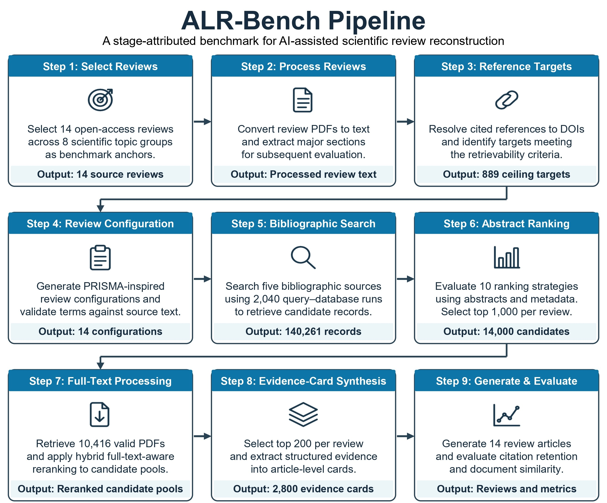
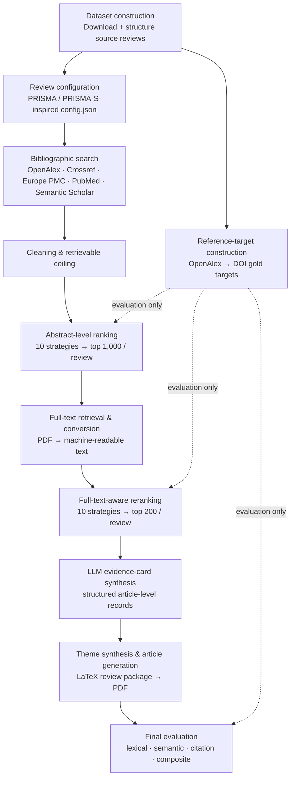

# ALR-Bench


**Benchmarking AI-Assisted Scientific Literature-Review Reproduction from Full-Text Evidence**

ALR-Bench is a full-text benchmark and end-to-end pipeline for evaluating how well an AI-assisted
workflow can *reproduce* a published literature review — from search and ranking through full-text
retrieval, evidence extraction, synthesis, and generated-article comparison.

It does **not** attempt fully autonomous systematic reviewing. Instead, it uses completed,
open-access review articles as evaluation anchors and measures each stage of the pipeline
separately, so the strengths and failure modes of review automation are made explicit.

- **Code & benchmark:** https://github.com/MuhammadMuneeb007/ALR-Bench
- **Generated review PDFs:** https://github.com/MuhammadMuneeb007/ALR-Bench/tree/main/GeneratedArticles
- **Exploratory biomedical application (LitVarAI):** https://github.com/MuhammadMuneeb007/LitVarAI

---

## Table of Contents

- [What this pipeline does](#what-this-pipeline-does)
- [Pipeline overview (flowchart)](#pipeline-overview-flowchart)
- [Headline results](#headline-results)
- [Repository layout](#repository-layout)
- [Quick start](#quick-start)
- [The pipeline, stage by stage](#the-pipeline-stage-by-stage)
- [Complete script inventory](#complete-script-inventory)
- [Detailed results](#detailed-results)
- [LLM configuration](#llm-configuration)
- [Wording rules (important)](#wording-rules-important)
- [Troubleshooting](#troubleshooting)
- [Reproduction status](#reproduction-status)
- [Citation](#citation)
- [Responsible use & licensing](#responsible-use--licensing)

---

## What this pipeline does

Starting from a set of known review articles, ALR-Bench:

1. Builds an evaluation dataset of open-access review articles.
2. Converts each review into Markdown and a structured project folder.
3. Extracts metadata, reference lists, and gold DOI targets from each review.
4. Generates one **review-specific configuration** per project (objective, concepts, eligibility, search terms).
5. Searches multiple bibliographic databases using that configuration.
6. Cleans and deduplicates the retrieved candidate articles.
7. Ranks candidates with ten **abstract/title** strategies.
8. Downloads and converts full text for the top candidates.
9. Re-ranks candidates with ten **full-text-aware** strategies.
10. Uses an LLM to build structured **evidence cards** for the top-ranked articles.
11. Synthesizes themes and generates a complete **review-article package** (LaTeX → PDF).
12. Evaluates the generated review against the original source review.

The gold DOI reference list of each source review is used **only for evaluation**. It is never
supplied to configuration generation, ranking, evidence-card synthesis, or article writing.

---

## Pipeline overview (flowchart)

Your figure (adjust the path if it lives elsewhere in the repo):


A native Mermaid version (renders directly on GitHub, no image file required):



---

## Headline results

> Results below are the **complete benchmark** as reported in the paper (14 reviews, all stages finished).
> See [Reproduction status](#reproduction-status) for how to regenerate them and how to read the
> `project_truth.json` canonical counts.

| Stage | Key result |
|---|---|
| **Benchmark** | 14 open-access source reviews · 8 topic groups · 2018–2024 · 373 PDF pages · 194,963 words |
| **Reference targets** | 1,348 OpenAlex referenced works → 1,197 DOI targets identified → **1,177 accessible** |
| **Configuration grounding** | 818 / 1,045 configured terms matched source text = **78.3% coverage** |
| **Search** | 761 unique queries · 2,040 query–database runs · **140,261 records** · 82,255 unique candidates |
| **Retrievable ceiling** | **889** DOI targets theoretically recoverable |
| **Abstract ranking** | best = SciBERT-style; **378 / 411** ranked-pool matches by C@1000 (92.0%) |
| **Full text** | 14,000 selected → **10,416 PDFs (74.4%)**; 10,426 usable text reps (74.47%) |
| **Full-text reranking** | best = hybrid fusion; 68 @50 · 119 @100 · 177 @200 · 291 @500 (of 377 pool matches) |
| **Evidence cards** | **2,800 processed** · 2,242 include · 450 exclude · 108 uncertain · 0 failed |
| **Final evaluation** | TF–IDF 0.6996 · SBERT 0.7561 · WMD 0.8494 · light composite 0.3380 · heavy 0.4154 |

**Interpretation:** generated reviews reproduce broad topical and semantic content
(high TF–IDF / SBERT / WMD) far more than exact wording or citation sets (low ROUGE-L 0.0982,
BLEU-4 0.0239, DOI-Jaccard 0.0160) — exactly what is expected from evidence-grounded synthesis
rather than verbatim reconstruction.

---

## Repository layout

```
ALR-Bench/
├── README.md
├── Images/
│   └── Flowchart.jpg                  # pipeline figure
├── GeneratedArticles/                 # compiled generated review PDFs
├── Projects/                          # per-review working data (often gitignored)
│   └── <project>/
│       ├── article.md                 # source review as Markdown
│       ├── article_metadata.json
│       ├── references_gold.json        # gold DOI targets (evaluation only)
│       ├── config.json                 # review-specific configuration
│       ├── Search/                     # search + cleaning outputs
│       ├── Extractions/Step16_*/article_json/*.json   # evidence cards
│       └── FinalArticle/               # generated LaTeX package + project_truth.json
├── Dataset1-7 *.py                    # dataset construction + configuration
└── Step7-20 *.py                      # search → ranking → full text → synthesis → eval
```

> **Note on script naming.** Dataset-building scripts are prefixed `Dataset…`; downstream
> pipeline scripts are prefixed `Step…`. The "Step N" headings below are *conceptual pipeline
> stages* and do not always equal the number in a filename.

---

## Quick start

```bash
# from the repository root (or the FinalCode/ subfolder if you keep one)
pip install -r requirements.txt        # bibliographic APIs, PDF tools, embedding models, LaTeX deps
cp .env.example .env                   # then add your LLM_API_KEY (see LLM configuration)
```

Then run the stages in order (details in the next section). A typical end-to-end run for a
single project finishes with:

```bash
python Step18.1-GenerateArticle.py 1 --max-cards 200 --max-table-rows 200 \
    --included-only --generate 1 --max-themes 8 --force --compile 1 --progress-interval 10
python Step20-Evaluate.py
```

---

## The pipeline, stage by stage

### Stage 1 — Dataset construction

Builds the evaluation set from known review articles and turns each into a structured project.

| Script | What it does | Output |
|---|---|---|
| `Dataset1-DownloadResearchArticleForSystemEvaluation.py` | Downloads/collects review articles for evaluation. | Review article records & files |
| `Dataset2-DownloadResearchArticle-Information.py` | Saves review metadata and dataset-report info. | Dataset CSV / report files |
| `Dataset3-ConvertArticlesToMarkdown.py` | Converts each review PDF into Markdown + project folder. | `Projects/<project>/article.md` |
| `Dataset4-StructureArticles.py` | Builds structured evidence/reference packs and gold DOI lists. | `article_metadata.json`, `references_gold.json` |
| `Dataset5-DatasetStatistics.py` | Prints dataset statistics and BibTeX/metadata info. | Console statistics |

> Source reviews must carry their OpenAlex `referenced_works` so cited works can be resolved into
> DOI-based gold targets used **only** for evaluation.

### Stage 2 — Review configuration

| Script | What it does | Output |
|---|---|---|
| `Dataset6-GenerateConfiguration.py` | Generates one flat `config.json` per project (objective, concepts, eligibility, search terms, screening/quality fields). | `Projects/<project>/config.json` |
| `Dataset7-ValidateConfiguration.py` | Checks whether configured terms actually appear in the source-review text (grounding check). | Validation report |

### Stage 3 — Bibliographic search, cleaning & retrievable ceiling

| Script | What it does | Output |
|---|---|---|
| `Step7-SearchLiterature.py` | Searches configured databases (OpenAlex, Crossref, Europe PMC, PubMed, Semantic Scholar). | `Search/articles.csv` |
| `Step8-Cleaning.py` | Deduplicates, filters DOI metadata, standardizes records. | `Search/articles_clean_doi_only.csv` |
| `Step8.1-CalculateCeiling.py` | Computes the retrievable ceiling vs gold DOI targets. | Ceiling / diagnostic reports |
| `Step8.2-PrintStatistics.py` | Prints search & cleaning statistics. | Console statistics |

### Stage 4 — Abstract-level ranking

Ranks candidates using title/abstract/metadata + configuration only (no full text).

| # | Script | Strategy |
|---:|---|---|
| 1 | `Step9-Rank1-ConfigBM25.py` | Config-weighted BM25 / lexical baseline |
| 2 | `Step9-Rank2-ReviewIntentSBERT.py` | Review-intent semantic / cross-encoder |
| 3 | `Step9-Rank3-TitleObjectiveSentenceTransformer.py` | Title/objective semantic |
| 4 | `Step9-Rank4-ConceptKeywordCoverage.py` | Concept & keyword coverage |
| 5 | `Step9-Rank5-GeneratedQueryMatch.py` | Generated/reported query matching |
| 6 | `Step9-Rank6-BooleanSoftMatch.py` | Boolean soft matching |
| 7 | `Step9-Rank7-FieldWeightedLexical.py` | Field-weighted lexical |
| 8 | `Step9-Rank8-SciBERTSemantic.py` | Scientific/biomedical semantic (**best overall**) |
| 9 | `Step9-Rank9-SPECTER2Semantic.py` | SPECTER/SPECTER2 paper-level semantic |
| 10 | `Step9-Rank10-HybridFusion.py` | Hybrid reciprocal-rank fusion |

Reporting: `Step9-PrintRanking.py` (ranking tables) · `Step9-Diagnosis.py` (C@10–C@3000 diagnostics).
The top **1,000** candidates per review are carried forward.

### Stage 5 — Full-text retrieval & conversion

| Script | What it does | Output |
|---|---|---|
| `Step11-DownloadFullText.py` | Downloads full text / PDFs for top candidates. | PDF / full-text files |
| `Step12-PrintStatistics.py` | Prints full-text download statistics. | Console statistics |
| `Step13-ConvertToFullText.py` | Converts PDFs/full text to machine-readable text. | `COMBINED.md` etc. |
| `Step13.1-PrintConvertTextStatistics.py` | Prints conversion statistics. | Console statistics |

### Stage 6 — Full-text-aware reranking

Re-ranks the same 1,000-record pool, now using full text where available.

| # | Script | Strategy |
|---:|---|---|
| 1 | `Step14-FullRank1-ConfigBM25.py` | Full-text config BM25 |
| 2 | `Step14-FullRank2-ReviewIntentSBERT.py` | Full-text review-intent semantic |
| 3 | `Step14-FullRank3-TitleObjectiveSentenceTransformer.py` | Full-text title/objective semantic |
| 4 | `Step14-FullRank4-ConceptKeywordCoverage.py` | Full-text concept/keyword coverage |
| 5 | `Step14-FullRank5-GeneratedQueryMatch.py` | Full-text generated-query matching |
| 6 | `Step14-FullRank6-BooleanSoftMatch.py` | Full-text Boolean soft match |
| 7 | `Step14-FullRank7-FieldWeightedLexical.py` | Full-text field-weighted lexical |
| 8 | `Step14-FullRank8-SciBERTSemantic.py` | Full-text SciBERT/BGE semantic |
| 9 | `Step14-FullRank9-SPECTER2Semantic.py` | Full-text SPECTER/SPECTER2 semantic |
| 10 | `Step14-FullRank10-HybridFusion.py` | Full-text hybrid fusion (**best overall**) |

Reporting: `Step14-PrintRanking.py` · `Step14-Diagnosis.py`.
The top **200** articles per review are carried forward.

### Stage 7 — LLM evidence-card synthesis

| Script | What it does | Output |
|---|---|---|
| `Step16-Synthesis.py` | Builds structured article-level evidence cards from the top 200 full-text articles. | `Projects/<project>/Extractions/Step16_*/article_json/*.json` |

Each card stores a screening decision (include / exclude / uncertain), confidence, methods,
datasets, outcomes, metrics, numerical results, findings, limitations, and a short summary.

### Stage 8 — Progress tracking, article generation, diagrams, evaluation

| Script | What it does | Output |
|---|---|---|
| `Step17-ListProgress.py` | Lists per-project progress across stages. | Console |
| `Step18.1-GenerateArticle.py` | Builds the full review package: canonical counts, themes, evidence packs, sections, references, validation reports, compiled PDF. | `FinalArticle/` |
| `Step19-GenerateDiagrams.py` | Generates local diagrams / tables / JSON summaries. | Diagram & table files |
| `Step20-Evaluate.py` | Compares generated PDFs against source-review PDFs with multiple metrics. | Evaluation tables |

**Article generation examples**

```bash
# Fast rebuild without the LLM (structure + tables only)
python Step18.1-GenerateArticle.py 1 --max-cards 200 --max-table-rows 200 \
    --included-only --generate 0 --compile 0

# Full generation with the LLM + PDF compile
python Step18.1-GenerateArticle.py 1 --max-cards 200 --max-table-rows 200 \
    --included-only --generate 1 --max-themes 8 --force --compile 1 --progress-interval 10
```

Key `FinalArticle/` outputs:

| Output | Purpose |
|---|---|
| `Main.tex` / `Main.pdf` | Generated review source & compiled PDF |
| `reference.bib` | DOI-enriched references |
| `bibtex_doi_cache.json` | DOI→BibTeX cache (avoids repeat API calls) |
| `project_truth.json` | Locked canonical counts for the project |
| `review_theme_schema.json` | Canonical themes & theme count |
| `article_theme_assignments.json` | Multi-theme article assignments |
| `theme_evidence_packs.json` / `theme_synthesis_briefs.json` | Theme evidence & briefs |
| `GeneratedTables.tex` | Deterministic flow diagram & descriptive tables |
| `Reports/FINAL_*_report.json` | Citation, numeric-provenance, theme-consistency, count-wording, and compile validation |

---

## Complete script inventory

| File | Role | Status |
|---|---|---|
| `Dataset1-DownloadResearchArticleForSystemEvaluation.py` | Download review articles for evaluation | Active |
| `Dataset2-DownloadResearchArticle-Information.py` | Save review metadata / report info | Active |
| `Dataset3-ConvertArticlesToMarkdown.py` | Convert reviews to Markdown / project files | Active |
| `Dataset4-StructureArticles.py` | Structure review content & references | Active |
| `Dataset5-DatasetStatistics.py` | Print dataset statistics | Active |
| `Dataset6-GenerateConfiguration.py` | Generate review configuration | Active |
| `Dataset7-ValidateConfiguration.py` | Validate generated configuration | Active |
| `Step7-SearchLiterature.py` | Search candidate literature | Active |
| `Step8-Cleaning.py` | Clean / deduplicate candidates | Active |
| `Step8.1-CalculateCeiling.py` | Compute retrievable ceiling | Active |
| `Step8.2-PrintStatistics.py` | Print search statistics | Active |
| `Step9-Rank1…Rank10-*.py` | Abstract/title ranking strategies (10) | Active |
| `Step9-PrintRanking.py` | Print Step9 ranking tables | Active |
| `Step9-Diagnosis.py` | Step9 C@K diagnostics | Active |
| `Step11-DownloadFullText.py` | Download full text / PDFs | Active |
| `Step12-PrintStatistics.py` | Print full-text statistics | Active |
| `Step13-ConvertToFullText.py` | Convert full text / PDFs to text | Active |
| `Step13.1-PrintConvertTextStatistics.py` | Print conversion statistics | Active |
| `Step14-FullRank1…FullRank10-*.py` | Full-text-aware ranking strategies (10) | Active |
| `Step14-PrintRanking.py` | Print full-text ranking summary | Active |
| `Step14-Diagnosis.py` | Full-text ranking diagnostics | Active |
| `Step16-Synthesis.py` | Generate LLM evidence cards | Active — **confirm committed** |
| `Step17-ListProgress.py` | List pipeline progress | Active |
| `Step18.1-GenerateArticle.py` | Generate final review package | Active |
| `Step19-GenerateDiagrams.py` | Generate diagrams / tables | Active |
| `Step20-Evaluate.py` | Evaluate generated outputs | Active |

> **Cleanup TODO (from the old README):** archive/remove any empty placeholder scripts
> (`Step11.1-DownloadTest.py`, `Step15-FullTextSummary.py`, `Step18.1-CombineInformation.py`,
> `Step9-FinalRankingChecking.py`) and the backup `Step18.1-GenerateArticle copy.py` so the
> repository contains only working, documented files.

---

## Detailed results

### Dataset

| Component | Value |
|---|---|
| Source reviews | 14 open-access review articles |
| Topic groups | 8 (bioinformatics, code generation, education, LLM evaluation, ML, psychology, public health, social science) |
| Publication years | 2018–2024 |
| Total PDF pages / words | 373 / 194,963 |
| OpenAlex referenced works | 1,348 |
| DOI targets identified | 1,197 |
| Accessible DOI targets (evaluation set) | 1,177 |
| Mean accessible targets / review | 84.1 |

### Configuration grounding

| Group | Found / Total | Coverage |
|---|---|---|
| Concept terms | 167 / 170 | 98.2% |
| Reported search terms | 172 / 186 | 92.5% |
| Generated search terms | 142 / 179 | 79.3% |
| Generated abstract-screening terms | 127 / 146 | 87.0% |
| Generated full-text-screening terms | 113 / 125 | 90.4% |
| **Overall** | **818 / 1,045** | **78.3%** |

### Search & retrievable ceiling

| Component | Value |
|---|---|
| Unique query texts | 761 |
| Query–database runs (success / fail / zero) | 2,040 (1,752 / 288 / 418) |
| Returned records | 140,261 |
| Unique candidates (with DOI) | 82,255 (79,068) |
| Retrievable ceiling | 889 (75.5% of accessible DOI targets) |

### Ranking (DOI reference recovery)

| Stage | Best strategy | Key C@K |
|---|---|---|
| Abstract-level (411 pool matches) | SciBERT-style | 378 @1000 (92.0%); title-objective 409 @3000 |
| Full-text-aware (377 pool matches) | Hybrid fusion | 68 @50 · 119 @100 · 177 @200 · 291 @500 |

### Full text & evidence cards

| Component | Value |
|---|---|
| Selected candidates | 14,000 |
| Valid PDFs retrieved | 10,416 (74.4%) |
| Usable machine-readable text | 10,426 (74.47%) |
| Evidence cards processed | 2,800 (0 failed) |
| Include / Exclude / Uncertain | 2,242 / 450 / 108 |

### Final generated-review evaluation (means over 14 reviews)

| Metric | Mean |
|---|---|
| TF–IDF cosine | 0.6996 |
| SBERT similarity | 0.7561 |
| Word Mover's Distance | 0.8494 |
| BERTScore F1 | 0.3843 |
| ROUGE-L | 0.0982 |
| BLEU-4 | 0.0239 |
| Citation DOI Jaccard | 0.0160 |
| Light composite | 0.3380 |
| Heavy composite | 0.4154 |

### Exploratory application — LitVarAI (telomere-gene variant extraction)

A downstream demonstration of the same full-text evidence-mining components on biomedical
literature. **Exploratory only — not part of the primary benchmark.**

| Component | Value |
|---|---|
| Target genes | 13 telomere / telomerase-associated |
| ClinVar variant records / unique PMIDs | 7,519 / 664 |
| Gene-specific articles (with DOI) | 730 (640) |
| Full-text retrieved & converted | 617 |
| Articles with AI extraction response | 543 |
| Articles with ≥1 extracted variant | 342 |
| Variant rows / unique variants | 2,181 / 1,329 |
| Provisional / strict-concordant ClinVar matches | 194 / 183 |

> The `POT1` gene run is incomplete (PDFs converted but no AI response recorded) and should be
> rerun before this application is used as a gene-level benchmark.

---

## LLM configuration

`Step18.1-GenerateArticle.py` and `Step16-Synthesis.py` read `.env` automatically.

| Variable | Purpose |
|---|---|
| `LLM_PROVIDER` | Provider label, e.g. `deepseek` |
| `LLM_BASE_URL` | OpenAI-compatible base URL |
| `LLM_MODEL` | Model name |
| `LLM_API_KEY` | API key — **never commit this** |
| `LLM_TEMPERATURE` / `LLM_TOP_P` / `LLM_MAX_TOKENS` | Sampling & length controls |
| `LLM_REASONING_EFFORT` | Optional provider-specific setting |
| `PROGRESS_INTERVAL` | Heartbeat interval for DOI / LLM waits |

---

## Wording rules (important)

To keep generated text and documentation faithful to the pipeline:

| Use this | Avoid this |
|---|---|
| "*N* records were retrieved from configured databases" (e.g. 5,271 for one project) | "1,000 records were retrieved" |
| "1,000 records formed the top-ranked screening pool" | treating top-1,000 as the original retrieval count |
| "evidence-card completeness and extraction audit" | "quality assessment" (unless formal quality scores exist) |
| "studies may belong to multiple themes" | treating theme counts as mutually exclusive when multi-assignment is on |

---

## Troubleshooting

| Problem | Likely cause | Fix |
|---|---|---|
| References missing from PDF | BibTeX not run after first LaTeX pass | `pdflatex Main` → `bibtex Main` → `pdflatex Main` → `pdflatex Main` |
| Citations show as `?` | Invalid cite keys or stale `.bbl` | Check `Reports/FINAL_citation_report.json`; recompile |
| `Step18.1` seems stuck | DOI lookup or LLM request running | Use `--progress-interval 10`; cache is in `bibtex_doi_cache.json` |
| Numeric report has unknown numbers | Generated text contains numbers not in truth/cards | Check `Reports/FINAL_numeric_provenance_report.json` |
| Theme counts exceed included count | Multi-theme assignment enabled | Expected — keep the multi-assignment disclaimer |
| LLM key missing | `.env` not loaded | Add `LLM_API_KEY` to `.env` or pass `--llm-api-key` |

---

## Reproduction status

Canonical per-project counts are locked in `Projects/<project>/FinalArticle/project_truth.json`,
produced by `Step18.1-GenerateArticle.py`. To reproduce the full benchmark:

1. Run Stages 1–8 for all 14 projects.
2. Run `Step18.1-GenerateArticle.py` per project to write each `project_truth.json`.
3. Run `Step20-Evaluate.py` once all generated PDFs exist.

> **Note:** the published results above reflect the complete 14-review benchmark (2,800 evidence
> cards). If your local workspace is mid-run (e.g. fewer cards, only some `project_truth.json`
> files present), reconcile the per-project counts before treating local output as final.

---

## Citation

```bibtex
@article{muneeb_alrbench_2026,
  title   = {ALR-Bench: Benchmarking AI-Assisted Scientific Literature Review
             Reproduction from Full-Text Evidence},
  author  = {Muneeb, Muhammad and Ascher, David B.},
  year    = {2026},
  note    = {Code: https://github.com/MuhammadMuneeb007/ALR-Bench}
}
```

---

## Responsible use & licensing

ALR-Bench is an **evaluation and assistance framework**, not a replacement for expert-led
systematic reviewing. Final review protocols, eligibility decisions, study-quality appraisal,
evidence interpretation, and manuscript conclusions require human validation.

Full-text retrieval uses available identifiers, open-access sources, and accessible metadata.
The repository does **not** redistribute copyrighted or publisher-restricted full-text PDFs.
Users are responsible for complying with database terms of service, publisher policies,
institutional access rules, and copyright requirements.
